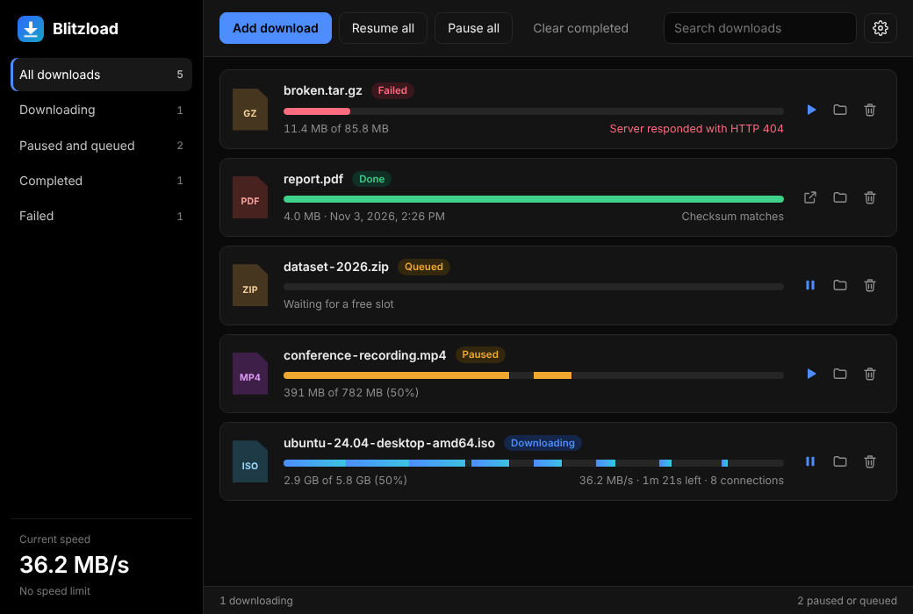

<div align="center">


# Blitzload

**Stop waiting on slow downloads.**
Blitzload splits every file across multiple connections, so it downloads faster, resumes where it left off, and never loses your progress.

[](https://github.com/YOUR-USERNAME/blitzload/releases/latest)
[](https://github.com/YOUR-USERNAME/blitzload/releases)
[](https://github.com/YOUR-USERNAME/blitzload/issues/new)

[](https://github.com/YOUR-USERNAME/blitzload/actions/workflows/test.yml)

[](LICENSE)

<br>



</div>

<br>

## Why Blitzload

Many servers limit how fast a single connection can go. Blitzload opens several at once and downloads different parts of the file at the same time, then joins them back together. The same file, often much sooner.

- **Multi-connection downloads.** Up to 32 connections per file. When one finishes early it takes over half of the biggest part left, so nothing sits idle until the very end.
- **Pause and resume that actually works.** Close the app, restart your computer, come back tomorrow. Your download carries on from where it stopped. If the file on the server changed in the meantime, Blitzload starts that one fresh instead of giving you a broken file.
- **A real queue.** Add as many downloads as you like and choose how many run at once. The rest wait their turn.
- **You stay in control of your bandwidth.** Set a speed limit in KB/s or MB/s so downloads don't take over your connection.
- **Survives bad connections.** Dropped connections are retried automatically with backoff.
- **Checks your files.** Paste a checksum (MD5, SHA-1, SHA-256 or SHA-512) and Blitzload tells you if the finished file matches.
- **Never overwrites.** If a file with that name already exists, you get `name (1).ext`.
- **Dark and easy on the eyes.** Each download's bar shows every connection filling its own slice of the file, so you can see the speed-up happening.

## Get it

1. Go to the **[latest release](https://github.com/YOUR-USERNAME/blitzload/releases/latest)**.
2. Download the installer for your system:
   - **Windows:** the `.exe` installer
   - **macOS:** the `.dmg`
   - **Linux:** the `.AppImage` or `.deb`
3. Run it.

> Installers are not code-signed yet, so Windows or macOS may show a warning the first time you open Blitzload. On Windows choose **More info**, then **Run anyway**. On macOS right-click the app and choose **Open**.

## Using it

Paste or drop a link anywhere in the Blitzload window, or click **Add download** and paste one or more links. Blitzload picks up the file name and size from the server and starts downloading. Use the buttons on each download to pause, resume, open the file, show it in its folder, or remove it.

Open **Settings** (the gear icon) to change:

| Setting | What it does |
| --- | --- |
| Connections per download | More connections means more parts at once. 8 to 16 works well for most servers. |
| Downloads at the same time | How many files download together before the rest queue. |
| Speed limit | Cap total download speed. 0 means no limit. |
| Retries after an error | How many times to retry a dropped connection. |
| Continue on startup | Pick unfinished downloads back up when Blitzload opens. |

Some servers don't allow downloading in parts. Blitzload still downloads those files, on a single connection, and tells you if a download can't be resumed.

## Run it from source

You need [Node.js](https://nodejs.org) 18 or newer.

```bash
git clone https://github.com/YOUR-USERNAME/blitzload.git
cd blitzload
npm install
npm start
```

Build an installer for your system:

```bash
npm run dist
```

Run the tests:

```bash
npm test
```

Pushing a tag such as `v1.0.0` makes GitHub build the Windows, macOS and Linux installers and attach them to a release automatically.

## How it's built

```
main.js, preload.js   Electron shell and the safe bridge to the window
src/engine.js         Download engine: parts, resume, speed limit, checksums
src/manager.js        Queue, settings, and saving state to disk
renderer/             The window (HTML, CSS, JavaScript)
test/                 Tests that run the engine against a local test server
```

## Contributing

Found a bug or have an idea? [Open an issue](https://github.com/YOUR-USERNAME/blitzload/issues/new). Pull requests are welcome. Please run `npm test` first.

## Roadmap

- Capture downloads straight from your browser with an extension
- Download scheduling
- Optional code-signed installers

## A note on downloading

Only download files you have the right to download, and follow the terms of the sites you use.

## License

MIT. See [LICENSE](LICENSE).
